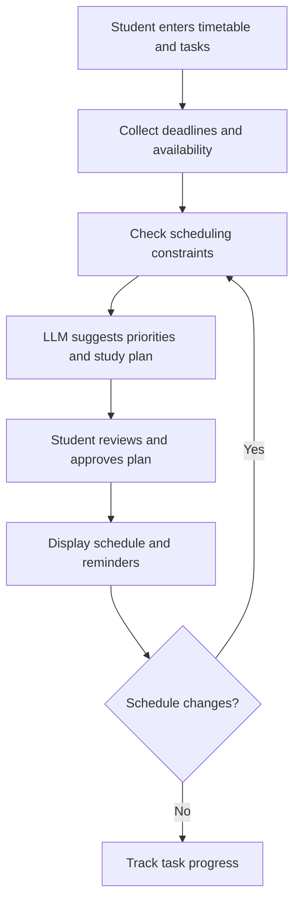

# Lab 02 – AI in Everyday Challenges

## Group 5 – The Busy Student

| Information | Details |
| --- | --- |
| Module | PUSL 3205 – Large Language Models and Generative AI |
| Laboratory | Lab 02 |
| Activity | Group 5 – The Busy Student |
| Product name | UniSync AI |
| Product type | AI-powered student productivity and time management application |
| LLM | ChatGPT (product concept and documentation assistance) |
| Group members | 33392  |
| Prototype status | Conceptual wireframe; not a functional application |

## 1. Objective

The objective of this laboratory activity is to apply Large Language Models (LLMs) to an everyday challenge faced by university students. The activity encourages critical thinking, problem-solving and creativity by using an LLM as a product-development partner to design a practical solution to a real-world problem.

## 2. Problem Statement

University students often struggle to balance lectures, assignments, group projects, independent studying, extracurricular activities, personal commitments and deadlines. Managing these responsibilities simultaneously can lead to forgotten tasks, last-minute submissions, poor time management and unnecessary stress.

Traditional calendars and to-do lists can help students record tasks, but students must often decide manually when to complete each activity and how to reorganize their schedules when priorities change.

**Design challenge:** Develop a product that helps busy university students organize their responsibilities and manage their time more effectively.

## 3. Proposed Solution – UniSync AI

**Tagline:** *Plan smarter. Study better. Live balanced.*

UniSync AI is a proposed AI-powered mobile productivity application designed specifically for university students. It combines academic scheduling, task prioritization, deadline reminders and personalized study planning in one platform.

Students would enter their lecture timetable, deadlines, estimated task durations and personal commitments. The AI assistant would suggest a realistic daily or weekly schedule, break large assignments into smaller tasks and propose adjustments when plans change. Students would review and approve suggested changes rather than allowing the AI to make important scheduling decisions automatically.

The main innovation is adaptive scheduling: instead of simply reminding students about deadlines, UniSync AI would help them decide what to do next and identify suitable times to complete their work.

## 4. Target Users

- Undergraduate and postgraduate university students.
- Students balancing academic work with part-time employment or internships.
- Students involved in group projects and extracurricular activities.
- Students who struggle with procrastination, overlapping commitments or missed deadlines.

## 5. Key Features

| Feature | Description | Expected benefit |
| --- | --- | --- |
| AI Smart Planner | Suggests a daily or weekly schedule based on deadlines, availability and estimated task durations. | Better time management |
| Intelligent Task Prioritization | Suggests task priorities using urgency, importance and workload. | Focus on important responsibilities |
| Adaptive Rescheduling | Proposes alternative time slots when a task is delayed or a commitment changes. | Greater flexibility |
| Smart Deadline Reminders | Provides configurable reminders before assignments, exams and meetings. | Fewer missed deadlines |
| Assignment Breakdown | Divides large assignments into manageable subtasks and milestones. | Reduced last-minute work |
| AI Study Assistant | Accepts natural-language requests for study planning and scheduling advice. | Easier planning |
| Focus Timer | Supports focused study sessions with scheduled breaks. | Improved concentration |
| Group Project Planner | Helps organize shared milestones and task responsibilities. | Better collaboration |
| Progress Dashboard | Displays completed tasks, upcoming deadlines and planned study time. | Improved workload awareness |
| Work–Life Balance | Reserves time for meals, rest, hobbies and personal commitments. | More sustainable study habits |

## 6. Product Development Process

The following outlines the proposed LLM-assisted design process. ChatGPT has been used to generate the product concept, suggested features and initial documentation. The prompts below are suggested follow-up experiments; run them and record the actual responses as evidence of the group activity.

| Stage | Purpose | Expected deliverable |
| --- | --- | --- |
| Problem identification | Identify the challenges experienced by busy students. | Clear problem statement |
| Idea generation | Brainstorm possible solutions with an LLM. | Alternative product ideas |
| Concept selection | Compare ideas based on usefulness, feasibility and innovation. | Selected product concept |
| Feature development | Refine the product's functionality and target audience. | Prioritized feature list |
| Prototype design | Design a simple interface and user journey. | Visual mock-up |
| Critical evaluation | Review the proposed solution, limitations and privacy concerns. | Improved product concept |

### 6.1 Suggested LLM Prompts

**Prompt 1 – Problem analysis**

> Act as a product development consultant. Identify the main time management challenges faced by university students balancing lectures, assignments, group projects, part-time work and personal commitments.

**Prompt 2 – Product ideation**

> Suggest five innovative product ideas that help busy university students manage their time. Compare their usefulness, feasibility and originality, and recommend a suitable concept.

**Prompt 3 – Feature design**

> Develop an AI-powered student productivity application called UniSync AI. Describe its target users, essential features, adaptive scheduling functionality and benefits. Prioritize the features needed for a minimum viable product.

**Prompt 4 – Prototype design**

> Design a mobile dashboard wireframe for UniSync AI. Include a daily timetable, prioritized tasks, upcoming deadlines, a progress indicator and an AI planning assistant. Keep the interface simple and student-friendly.

**Prompt 5 – Critical evaluation**

> Critically evaluate UniSync AI. Identify possible scheduling errors, unrealistic workloads, privacy risks and limitations of LLM-generated recommendations. Suggest practical safeguards and improvements.

### 6.2 Role of the LLM

The LLM acts as a product-development partner by supporting brainstorming, problem analysis, feature generation, interface planning and critical evaluation. Human review remains important because an LLM can suggest unrealistic schedules, overlook constraints or generate inaccurate information.

## 7. Visual Prototype / Mock-up

The following low-fidelity wireframe illustrates the proposed mobile dashboard. All displayed tasks and progress figures are fictional examples for demonstration purposes.

```text
+---------------------------------------+
| UniSync AI                       [=]  |
| Good morning, Student!                |
|---------------------------------------|
| TODAY'S PROGRESS                      |
| [##########----------]  50%            |
| 2 of 4 tasks completed                |
|---------------------------------------|
| TODAY'S SCHEDULE                      |
| 09:00  LLM Lecture                    |
| 11:00  Group Project Meeting          |
| 13:00  Lunch Break                    |
| 14:00  Assignment Research            |
| 16:00  Personal Time                  |
|---------------------------------------|
| PRIORITY TASKS                        |
| [!] HIGH   NLP Assignment - Tomorrow  |
| [ ] MEDIUM Group Project - Friday      |
| [ ] LOW    Revise Lecture Notes        |
|---------------------------------------|
| AI PLANNER                            |
| Suggested: Use your 14:00 free slot    |
| for assignment research.              |
| [Review plan]       [Ask AI]           |
|---------------------------------------|
| Home     Calendar     Tasks     AI    |
+---------------------------------------+
```

### 7.1 Proposed System Workflow



### 7.2 Example User Scenario

A student has a lecture at 9:00 AM, a group meeting at 11:00 AM and an assignment due the following day. The student asks:

> I have lectures and a group meeting today. My assignment is due tomorrow. Help me organize my study time without missing lunch or personal time.

An illustrative UniSync AI response could be:

| Time | Suggested activity |
| --- | --- |
| 09:00–10:30 | Attend lecture |
| 11:00–12:00 | Attend group project meeting |
| 12:00–13:00 | Lunch and rest |
| 13:00–14:00 | Research assignment |
| 14:00–14:15 | Short break |
| 14:15–15:15 | Complete assignment draft |
| 15:15–15:45 | Review and prepare for submission |
| 16:00 onwards | Personal time |

The student can approve or modify this suggested plan. This is an illustrative example, not a recorded output from a working scheduling application.

## 8. Results and Supporting Evidence

The current design deliverables are the proposed product name, concept, target audience, feature list, workflow and low-fidelity visual mock-up included in this README. No functional application, usability test or measured productivity improvement is claimed.

Add the group's actual evidence to the repository after completing the activity:

| Suggested file | Evidence to capture |
| --- | --- |
| `screenshots/01_problem_analysis.png` | LLM-assisted problem analysis |
| `screenshots/02_product_ideation.png` | Brainstorming and alternative product concepts |
| `screenshots/03_feature_design.png` | Feature generation and refinement |
| `screenshots/04_visual_prototype.png` | Final group-approved visual prototype |
| `screenshots/05_critical_evaluation.png` | LLM-assisted evaluation and improvements |
| `group-activity/group-members.md` | Group member details |
| `group-activity/activity-outcomes.md` | Actual group decisions and outcomes |
| `group-activity/discussion-summary.md` | Summary of group discussions and contributions |

## 9. Observations and Reflection

The conceptual design illustrates how an LLM can support idea generation and help organize complex product requirements into a structured proposal. Adaptive scheduling could offer greater flexibility than a static to-do list, especially when deadlines or academic commitments change.

However, AI-generated plans need human verification. An LLM may underestimate task duration, suggest overlapping activities or overlook personal circumstances. A practical implementation should use deterministic calendar conflict checks, accurate deadline data and user approval alongside AI recommendations. The product should also minimize collection of personal information, protect calendar data and allow users to control notifications.

These observations are design considerations rather than measured experimental findings. Add the group's actual experiences, challenges, decisions and feedback here after conducting the lab activity.

## 10. Learning Outcomes

This activity is intended to develop the ability to:

- Apply LLMs to real-world student challenges.
- Use prompt engineering to support product development.
- Identify user needs and translate them into practical product features.
- Develop a product concept and visual prototype.
- Critically evaluate AI-generated suggestions and identify limitations.
- Collaborate on problem-solving and communicate product ideas effectively.
- Understand the importance of responsible AI, privacy and human oversight.

## 11. Future Improvements

Potential improvements include university timetable integration, calendar synchronization, personalized study analytics, voice-based planning and shared group project scheduling. A future functional prototype could be evaluated using student feedback, scheduling accuracy, missed-deadline frequency and usability measures.

## 12. Conclusion

UniSync AI is a proposed AI-powered time management solution for the Busy Student challenge. By combining personalized planning, intelligent task prioritization and adaptive scheduling, the concept aims to help university students manage academic and personal responsibilities more effectively. The activity demonstrates how an LLM can assist with creative problem-solving and product design while human judgment remains essential to evaluating and refining its recommendations.

## 13. References

- PUSL 3205 – Lab Sheet 2: AI in Everyday Challenges, Group 5 – The Busy Student.
- Practical Assignment Brief – PUSL 3205 portfolio documentation requirements.