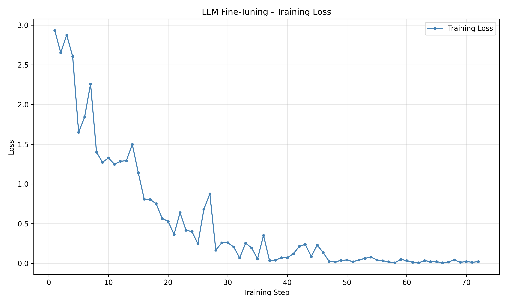
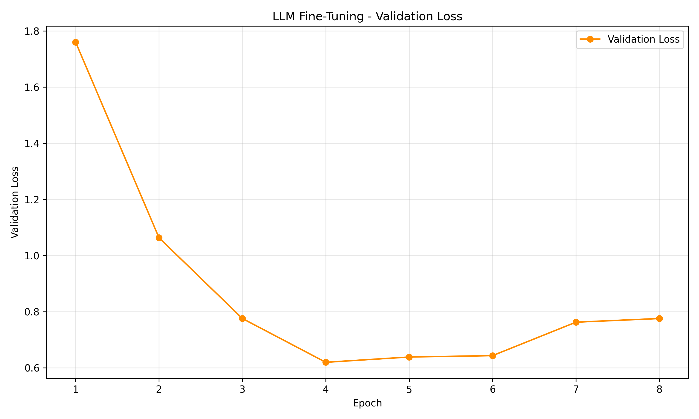
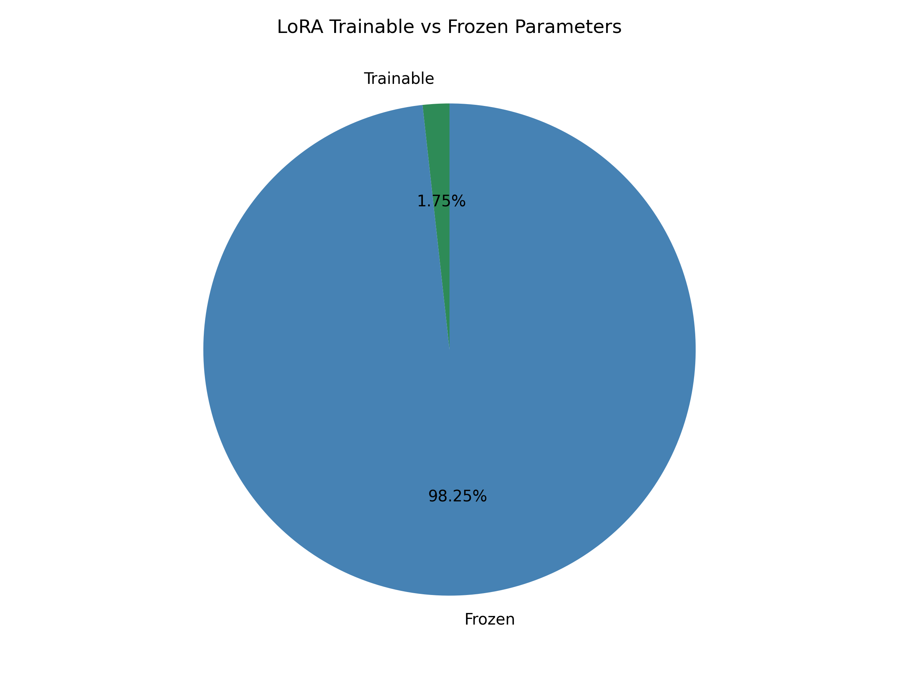
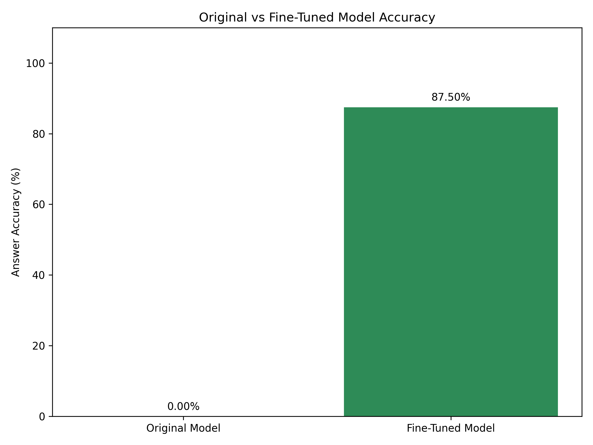
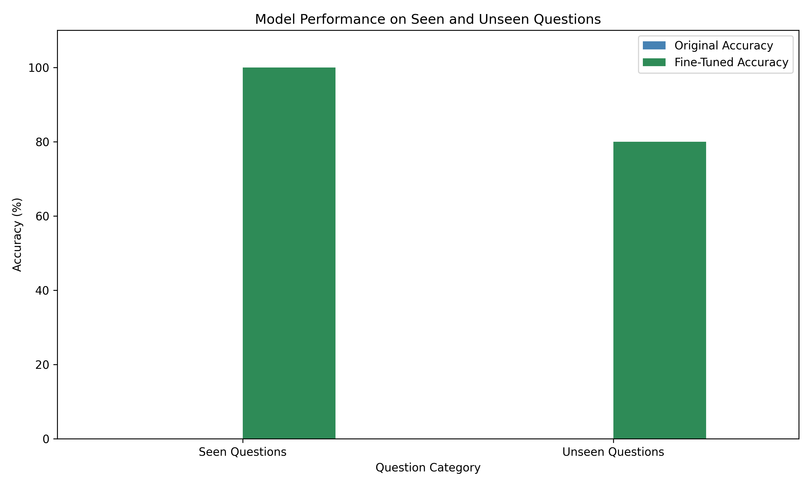

# Lab 04 – Fine-Tuning an LLM Using LoRA/QLoRA

**Module:** PUSL 3205 – Large Language Models and Generative AI

**Project:** TechZone AI Customer Service Assistant

## 1. Objective

The objective of this laboratory is to fine-tune
a pretrained instruction-tuned language model using
parameter-efficient fine-tuning techniques.

## 2. Tools and Technologies

- Python
- Google Colab
- PyTorch
- Hugging Face Transformers
- Hugging Face Datasets
- PEFT
- TRL
- Accelerate
- Bitsandbytes
- Pandas
- Matplotlib

## 3. Hardware Configuration

| Component | Specification |
|---|---|
| GPU | Tesla T4 |
| GPU Memory | 14.56 GiB |
| CUDA Version | 13.0 |
| Platform | Google Colab |

## 4. Model Selection

- Base Model: Qwen/Qwen2.5-0.5B-Instruct
- Model Type: Causal Language Model
- Fine-Tuning Method: LoRA
- Domain: Computer Shop Customer Service

## 5. Dataset

A custom question-answer dataset was created for
the fictional TechZone Computer Shop.

| Dataset | Examples |
|---|---:|
| Training | 36 |
| Validation | 6 |
| Testing | 8 |

The dataset includes questions about products,
pricing, warranty, repairs, delivery and discounts.

## 6. Implementation

1. Installed the required libraries.
2. Identified GPU resources.
3. Loaded the pretrained model and tokenizer.
4. Created a custom question-answer dataset.
5. Tested the original model.
6. Configured PEFT adapters.
7. Fine-tuned the model using SFTTrainer.
8. Evaluated the fine-tuned model.
9. Compared seen and unseen questions.
10. Saved and reloaded the trained adapters.

## 7. Training Configuration

| Hyperparameter | Value |
|---|---|
| Fine-Tuning Method | LoRA |
| LoRA Rank | 16 |
| LoRA Alpha | 32 |
| LoRA Dropout | 0.05 |
| Learning Rate | 0.0002 |
| Epochs | 8 |
| Batch Size | 2 |
| Maximum Sequence Length | 256 |
| Optimizer | AdamW |

## 8. Experimental Results

| Metric | Result |
|---|---:|
| Original Model Accuracy | 0.00% |
| Fine-Tuned Model Accuracy | 87.50% |
| Accuracy Difference | 87.50 percentage points |
| Validation Loss | 0.7757 |
| Perplexity | 2.1721 |
| Total Parameters | 502,830,976 |
| Trainable Parameters | 8,798,208 |
| Trainable Percentage | 1.7497% |
| Training Time | 115.46 seconds |

## 9. Visualizations

### Training Loss

### Validation Loss

### Parameter Distribution

### Accuracy Comparison

### Seen and Unseen Questions

## 10. Supporting Evidence

- [Jupyter Notebook](notebooks/lab04_llm_finetuning.ipynb)
- [Training Dataset](data/training_dataset.csv)
- [Validation Dataset](data/validation_dataset.csv)
- [Test Dataset](data/test_dataset.csv)
- [GPU Information](results/gpu_information.json)
- [Training History](results/training_history.csv)
- [Model Comparison](results/model_comparison.csv)
- [Scored Responses](results/scored_model_comparison.csv)
- [Trained Adapter](models/techzone_lora_adapter/)
- [Screenshots](screenshots/)

## 11. Observations and Reflection

The model was fine-tuned using a small domain-specific
dataset. Its responses were compared with the original
model using identical questions.

[Discuss actual changes in answer correctness.]

[Discuss performance on unseen questions.]

[Describe challenges encountered during fine-tuning.]

[Discuss incorrect or hallucinated answers.]

## 12. Learning Outcomes

- Understanding parameter-efficient fine-tuning.
- Configuring LoRA and QLoRA.
- Preparing instruction-based datasets.
- Using Hugging Face SFTTrainer.
- Fine-tuning pretrained language models.
- Evaluating seen and unseen questions.
- Saving and reusing trained adapters.

## 13. Limitations

- Small dataset and test sample.
- Possible overfitting.
- Potential hallucinations.
- Limited generalization.
- Subjective manual evaluation.

## 14. Future Improvements

- Increase dataset size and diversity.
- Compare multiple base models.
- Compare LoRA and QLoRA.
- Experiment with adapter hyperparameters.
- Improve evaluation methodology.

## 15. Conclusion

[Summarize the actual results and learning experience.]

## 16. References

- https://huggingface.co/Qwen/Qwen2.5-0.5B-Instruct
- https://huggingface.co/docs/transformers/
- https://huggingface.co/docs/peft/
- https://huggingface.co/docs/trl/
- https://arxiv.org/abs/2106.09685
- https://arxiv.org/abs/2305.14314